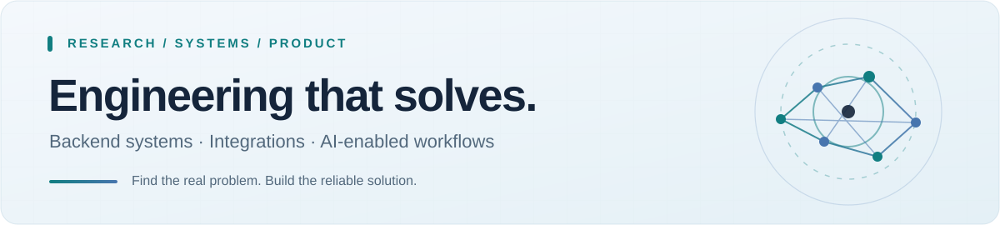

  <picture>
    <source media="(prefers-color-scheme: dark)" srcset="./assets/profile-hero-dark.svg">
    <source media="(prefers-color-scheme: light)" srcset="./assets/profile-hero-light.svg">
    
  </picture>

  <h1>Hi, I'm Sunny Kumar.</h1>

  
<strong>Software Engineer · Backend &amp; Integrations · Full-Stack Products · AI-Enabled Workflows</strong>

  
Research-minded engineer connecting business problems with dependable software.

  

    <a href="mailto:sunny.builds.dev@gmail.com"><strong>Email</strong></a>
    &nbsp; · &nbsp;
    <a href="https://www.linkedin.com/in/sunny-kumar105"><strong>LinkedIn</strong></a>
    &nbsp; · &nbsp;
    <a href="./PROJECTS.md"><strong>Engineering work</strong></a>
    &nbsp; · &nbsp;
    <a href="https://doi.org/10.1109/ICCCNT61001.2024.10725998"><strong>IEEE paper</strong></a>
  

---

### What I bring to a team

I combine **technical research, engineering depth, and business-process understanding** to solve problems that don't arrive with perfect specifications. I investigate how a workflow really behaves, identify correctness and operational risks, design a maintainable system, and validate it against real evidence.

My background includes **US healthcare technology**, cross-platform product engineering, and **sustainability and environmental software research**.

### Selected engineering work

**01 / Healthcare systems integration**  ·  *Professional work; source private*  
Worked on Python-based services for patient-search and encounter-history workflows around a stateful clinical platform. Areas include authentication/session lifecycles, Playwright-assisted native request generation, XML parsing, strict matching, privacy-safe diagnostics, reliability controls, deployment, and automated tests. **Read workflows were live validated**; additional broker and write-automation work had distinct development stages.

**02 / WOVO LOVE — privacy-first mobile product**  ·  *Application source private*  
Contributed across **React Native, Expo, TypeScript, Supabase/PostgreSQL**, discovery-state rules, Pass/Undo behavior, privacy-aware presentation, accessibility, and contract tests. The full safety and interaction ecosystem was not launched at the documented checkpoint.  
[View public landing-page prototype](https://github.com/sunnykumar-dev-105/wovo-love-landing)

**03 / Environmental technology and ESG research**  
Built and studied applications focused on sustainability education, resource tracking, and structured business reporting. My related work includes national Smart India Hackathon projects and an IEEE publication.  
[Postal ESG app](https://github.com/sunny1921/esg-app) · [BRSR and mobile projects](https://github.com/sunny1921/mobile_computing)

**04 / Operational product development**  
Earlier work includes **Flutter/Firebase point-of-sale workflows** and real-estate CRM features for leads, tasks, properties, and supporting operations.  
[FHAIDA CRM — public code](https://github.com/sunny1921/FHaiDA_CRM)

> **SKY ONE:** I also developed an environmental-awareness learning game. Its source and playable build have **not** been published here; I won't present it as a public repository.

**[Read my engineering project notes →](./PROJECTS.md)**

### Technologies & methods

| Work area | Selected tools and practices |
| :-- | :-- |
| Backend & integrations | **Python**, asynchronous services, REST APIs, Playwright, XML/SOAP, Docker |
| Frontend & mobile | **TypeScript**, React Native, Expo, React, Flutter, Dart |
| Data & security | **PostgreSQL**, Supabase/RLS, Firebase, MySQL, MongoDB, access control |
| Reliability | **pytest**, Ruff, mypy, contract testing, Git, controlled debugging |
| AI & research | LLM API workflows, AI-assisted engineering, TensorFlow project work, technical analysis |

### Research & recognition

- **Smart India Hackathon National Winner — 2023 and 2024** (two national wins).
- **Cisco ThinkQBator — Top-10 finalist.**
- **IEEE ICCCNT 2024:** [*From Theory to Action: ESG App for Sustainable Education*](https://doi.org/10.1109/ICCCNT61001.2024.10725998).
- **B.Tech in Computer Science & Engineering**, Rajiv Gandhi Institute of Petroleum Technology.

---

**Have a difficult integration, product, or operational workflow to solve?**

I'm interested in international remote engineering opportunities and selected, well-scoped collaborations.

[**Get in touch**](mailto:sunny.builds.dev@gmail.com) · [**Connect on LinkedIn**](https://www.linkedin.com/in/sunny-kumar105)

Professional project summaries are intentionally high-level. Private source code, credentials, patient information, and employer-confidential materials are not published here. Some public projects are hosted under an earlier collaborator/account identity.

